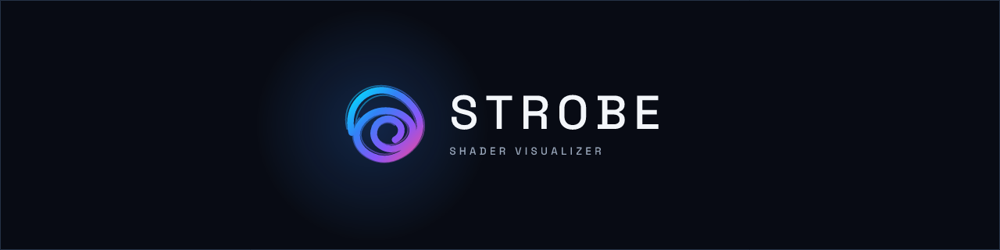
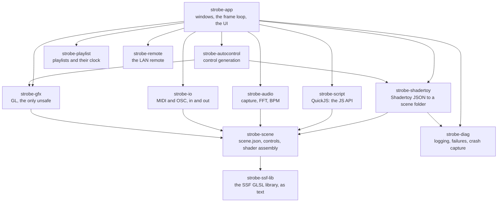

<div align="center">



# Strobe

**Live visuals that move with the music, for projectors, LED walls and old
laptops.**

</div>

Strobe turns sound into moving pictures. Plug a laptop into a projector,
play music (or let it listen through a microphone), and Strobe draws
animated graphics that pulse, swirl and change with the beat. You choose
the visuals, tweak them live with sliders or a MIDI controller, and line
them up into a show that runs for hours on its own.

It is free and open source, written in Rust, and built to run well on the
kind of old Windows laptop a small venue actually has.

> **Status: v0.2.0, for testing, not yet for production.**
> Everything below is built and tested. Windows is the target and has been
> checked on four real machines: a ThinkPad T480 (Intel UHD 620), desktops
> with a GTX 1080 Ti and an RX 580, and a venue mini-PC (Ryzen 3 3200U,
> Vega 3) driving a projector. Linux builds and runs, on X11 and Wayland,
> with a Nix flake and a package list for Debian and Ubuntu (see
> [Linux](#linux); checked on Mesa's software renderer, not yet on a real
> Linux GPU). macOS does not run yet. What is verified, and where, is in
> [`docs/STATUS_AUDIT.md`](docs/STATUS_AUDIT.md); what is not yet (MIDI
> hardware, live Shadertoy import, phones, an HD 4000) is on the
> [release page](https://github.com/lnorton89/strobe/releases) and in
> [`docs/COMPATIBILITY.md`](docs/COMPATIBILITY.md).


## New to this?

**VJing** is to video what DJing is to music: someone (the VJ) plays
visuals live, in time with the music, on the screens at a club, a gig or a
festival. Strobe is a tool for that, and for anyone who simply wants a
screen that dances to their music.

Each visual is a **scene**: a small program, a *shader*, that runs on the
graphics card and draws every pixel of every frame, about sixty times a
second. A scene can read the music (the bass, the beat, the tempo) and has
**controls**, sliders and buttons that change how it looks. Shaders are
written in a language called **GLSL**; you never need to read it to use
Strobe, but you can edit any scene if you want to.

**Where the scenes come from.** Strobe borrows two well-known formats, so
there are thousands of visuals it can play:

- **Synesthesia** ([synesthesia.live](https://synesthesia.live)) is a
  commercial music visualizer for Mac and Windows. Its scenes are folders
  ending in `.synScene` (the *Synesthesia Shader Format*, SSF), holding the
  shader (`main.glsl`), its controls and settings (`scene.json`) and
  sometimes a JavaScript file (`script.js`). Strobe plays those folders
  unchanged: Synesthesia's own scenes if you have it installed, community
  scenes, and Strobe's own. Strobe is an independent project; it is not
  made by, endorsed by or affiliated with Synesthesia's makers, and it
  ships none of their scenes.
- **[Shadertoy](https://www.shadertoy.com)** is a website where people
  share shaders. Strobe imports one from its page and makes it react to
  your music.

**Who it is for:**
- a DJ, band or venue that wants visuals without a powerful computer;
- a VJ running long nights who wants a show to play itself, with a hand on
  the controls when it matters;
- Synesthesia users who want their scenes on more machines;
- shader artists who want an audience-ready player for their work.

**Try it.** On Windows: download the zip from the
[Releases](https://github.com/lnorton89/strobe/releases) page, unzip it,
and run `strobe.exe` (nothing to install). Click a scene in the library to
make it play, press **F11** to put it on the second screen, and choose your
microphone or line-in under **Settings > Audio**. The
[user guide](docs/USER_GUIDE.md) walks through everything else.

### Words you will see

| Word | What it means here |
|---|---|
| Scene | One visual: a folder with a shader, its controls and settings. |
| Shader, GLSL | The small program that draws a scene on the graphics card, and the language it is written in. |
| SSF, `.synScene` | Synesthesia's scene format, which Strobe reads as it is. |
| Control | A slider, button, colour or switch that changes a scene while it plays. |
| Meta controls | Controls for the whole output, whatever the scene: brightness, colour, mirrors. |
| Preset, fav slot | A saved look of a scene, and one of eight buttons that recalls a scene with a look. |
| Macro | One knob or key that moves several controls at once. |
| Playlist, cue | A show written ahead: a list of scenes (cues), how long each plays and how it hands over. |
| Transition | How one scene gives way to the next: a cut, a crossfade or a custom blend. |
| MIDI, OSC | The two ways hardware controllers and other apps talk to Strobe. |
| ANGLE | A translation layer (the one Chrome uses) that lets Strobe draw through Direct3D when a laptop's OpenGL driver is broken. |
| BLACKOUT | The button that sends black to the screen at once, always in the same place. |

---

## What it does

**Plays Synesthesia scenes as they are.** It reads `main.glsl`,
`scene.json` and `script.js`, including:
- scenes drawn in several passes, and SSF's library of shader helpers;
- every control type, with smoothing, speed, bangs and counters;
- images, cube maps, media, and transitions that give a scene a new look
  when a new song starts (or when you press **New song**);
- the JavaScript API (`setup`, `update`, `setControl`, `setUniform`,
  `meta/` writes, `textureFinalPass`).

Real-world results:
- **65 owner-supplied scenes on NVIDIA:** 63 play with their scripts. The
  other two have bugs of their own.
- **A private 90-scene corpus:** 87 compile and render in both GL dialects.

**Imports Shadertoy shaders.** A "Send to Strobe" userscript
([`tools/userscript/`](tools/userscript/)) posts a shader from its page to
the app's local listener. The app converts it into an ordinary scene folder
that keeps the source and licence:
- buffers A to D become passes;
- the audio channel is your live sound;
- a generated control group adds speed, audio-driven time, a bass flash,
  zoom and hue.

**Generates controls for scenes that have none.** It finds the numbers
that shape a scene (colours, scales, speeds and loop counts) and turns them
into sliders, keeping only those that measurably change the picture. You
review them, keep the ones you like, and save them into the scene (the
files they replace are backed up first) or into a copy. This runs in a
worker process, so the show keeps playing.

**Runs long shows from playlists.**
- **Inheritance:** a cue that names only a scene is complete. Duration,
  advance and transition come from its section and the playlist.
- **Writing a show:** playlists are TOML you can write by hand
  ([`playlists/`](playlists/)), or the Generate card builds a section from
  scene `TAGS` with a seed.
- **During the show:** every scene is compiled before it starts, the next
  scene warms up off screen, crossfades and custom transitions mix two live
  scenes, and the show resumes after a crash.

**Takes show control** from hardware and other software.
- **MIDI and OSC in**, with learn, soft takeover and curves.
- **OSC feedback out**, so TouchOSC or motorised faders follow the show.
- **Performance Macros**, presets, and eight fav slots.
- **Keyboard shortcuts**, which you can rebind in the app.
- **Output-wide meta controls**: master, colour, mirrors and Limit Colors.
  They carry from scene to scene.

**Has a performer-first UI.**
- **A rail of views:** Library, Controls, Import, Playlist, Editor, Mappings,
  Diagnostics and Settings, beside a side panel that is always there: the
  live preview, frame rate and audio, the eight fav slots, and the
  playlist, controls, presets and scene tabs.
- **The transport and BLACKOUT stay put** at the bottom, with the macro strip.
- **A command palette** (Ctrl+K).
- **A scene editor:** Save and reload, with the last good scene kept playing
  if the edit fails to compile.
- **Tag search, favourites and scene thumbnails** in the library, and native
  file and folder pickers wherever a path is asked for.

**Takes remote control over the LAN** (opt-in, trusted networks only).
- **From a phone:** open the address Settings shows, give the phone a name,
  and approve it on the laptop. No code to type.
- **From another Strobe:** Strobes with remote control on find each other on
  the network; a desktop asks, and the host approves or denies it.
- **Venue mode:** a trust file lets a laptop drive the show machine and
  reconnect by itself.

**Stays up on bad hardware.**
- **The floor is OpenGL 3.3**, roughly a 2012 Intel HD 4000.
- **Adaptive resolution** keeps heavy scenes at the display's frame rate.
- **ANGLE fallback:** when the native GL driver fails, Strobe uses ANGLE
  (OpenGL ES on Direct3D 11). `--gl angle-vulkan` (or `angle-gl`) runs ANGLE
  on another of its backends.
- **Context recovery:** a lost GL context is rebuilt and the show carries on.
- **Runaway scripts are stopped** within a per-frame budget.
- **Crashes leave evidence:** a report and a minidump that
  `cargo xtask symbolicate` turns into a stack with file and line.

| | Synesthesia | Strobe |
|---|---|---|
| Scene format | SSF | SSF, read as-is; Strobe's extensions are extra keys Synesthesia ignores |
| Shadertoy | Ported by hand | Imported from the page, multipass, live audio |
| Playlists | Each item carries its own settings | Inherited settings, a tag-based generator, beat-locked lengths, a wall-clock anchor |
| Broken GL driver | Does not start | Falls back to ANGLE |
| A `while(true){}` in a script | Hangs | Interrupted; the scene keeps rendering |

---

## Architecture

A Cargo workspace of fifteen crates. The rules that matter:
- **Only the app knows about everything.**
- **Only `strobe-gfx` touches the GPU.**
- **Everything that can be tested without a GPU is.**



Arrows point at what a crate depends on (the main edges; ARCHITECTURE.md
has every one). `strobe-playlist`, `strobe-remote`
and `strobe-diag` depend on no other Strobe crate. `strobe-bench`
(benchmarks), `strobe-conventions` (the house rules as tests) and `xtask`
(repository tooling) sit beside the app, not under it.

| Crate | What it owns |
|---|---|
| [`strobe-app`](crates/strobe-app/README.md) | The `strobe` binary. Two windows on one GL context, the frame loop, the egui UI (`ui/`), the show runner (`show/`), the editor, context-loss recovery. Also `strobe-corpus`, the compatibility harness: it loads, compiles and renders every scene of a library, scripts included, in both GL dialects, and writes a report. |
| [`strobe-gfx`](crates/strobe-gfx/README.md) | The GL boundary (the only `unsafe`, in `gl/`), context providers (native, ANGLE, headless, offscreen), the scene player, compositor, post stage, GPU timing and adaptive resolution. |
| [`strobe-scene`](crates/strobe-scene/README.md) | The SSF model: `scene.json` into a checked `SceneDef`, the control runtime, meta controls, presets, tags, and the shader assembler with its GLSL ES rewrites. No GL, no clock. |
| [`strobe-ssf-lib`](crates/strobe-ssf-lib/README.md) | The SSF GLSL function library and preambles. |
| [`strobe-script`](crates/strobe-script/README.md) | The QuickJS host for Synesthesia's JavaScript API, with an interrupt budget and a conformance suite. |
| [`strobe-audio`](crates/strobe-audio/README.md) | Capture on its own thread, FFT, bands, onsets, BPM, and the audio textures; a synthetic 120 BPM track for tests. |
| [`strobe-playlist`](crates/strobe-playlist/README.md) | Playlists: the model, TOML, inheritance, the seeded generator, the timeline and the playback clock. Pure. |
| [`strobe-io`](crates/strobe-io/README.md) | Show control: MIDI and OSC workers, mappings with learn and soft takeover, macros, OSC feedback, `show-control.json`. Never touches GL. |
| [`strobe-shadertoy`](crates/strobe-shadertoy/README.md) | Shadertoy import: URL and id parsing, the converter to a scene folder, the REST client, texture cache, the loopback listener, and `strobe-import`. |
| [`strobe-autocontrol`](crates/strobe-autocontrol/README.md) | Control generation: finds candidate literals, rewrites them to uniforms, renders to score each one, keeps those that matter. Also the `strobe-autocontrol` binary. |
| [`strobe-diag`](crates/strobe-diag/README.md) | Logging, the session context, structured failures, the panic hook and out-of-process crash capture with minidumps. |
| [`strobe-remote`](crates/strobe-remote/README.md) | LAN control from phones and other Strobe desktops: typed protocol, bounded app bridge, scoped pairing and revocation, phone controller page and optional full desktop UI streaming (trusted networks only). |
| [`strobe-bench`](crates/strobe-bench/README.md) | Renders every scene in `scenes/`, times it, and writes frames, a contact sheet and `results.md`. |
| [`strobe-conventions`](crates/strobe-conventions/README.md) | The house rules as tests: file headers, the `unsafe` boundary, the toolchain pin. |
| [`xtask`](crates/xtask/README.md) | `cargo xtask ci`, `changelog`, `bench`, `corpus`, `symbolicate`, `brand`. |

### Graphics: native OpenGL, ANGLE as the fallback

Scenes are GLSL, and native GL hands GLSL straight to the driver's compiler,
as Synesthesia does. That is why Strobe does not use wgpu: its GLSL frontend
rejects too much real shader code. On Windows the native (WGL) path is the
one that breaks on hybrid-graphics laptops and old drivers, so the context is
a provider. Strobe tries native GL 3.3 core first. If that fails, or if
`--gl angle` asks, it opens OpenGL ES 3.0 through
[ANGLE](https://chromium.googlesource.com/angle/angle) on Direct3D 11, the
path Chrome uses. `--gl angle-vulkan`, `angle-gl` or `angle-d3d11` names
ANGLE's backend, and a backend ANGLE cannot start on is reported, never
quietly swapped (D485). Everything above the context is the same code.

Every scene, imported Shadertoy shaders included, compiles as
`#version 330 core` on desktop GL and `#version 300 es` on ANGLE. The
assembler makes real SSF code valid GLSL ES:
- it writes out the implicit int-to-float conversions desktop drivers allow;
- it moves global initializers that are not constant into `main`;
- it reads an `#if` on an undefined name as 0.

### A frame

One thread owns the GL context and runs the frame. Workers for audio,
MIDI, OSC, OSC feedback, the import listener, the LAN remote and its
discovery, file dialogs, file saving and the crash monitor only hand values
to it, through bounded queues it never waits on.
Each output frame, in order:

1. Drain MIDI and OSC into the control banks and commands, and queue OSC
   feedback for what has changed.
2. Advance the playlist clock: start cues, warm up the next scene, and run
   transitions.
3. Advance each live scene:
   - read its audio;
   - run its script;
   - tick its controls;
   - render its passes.
4. Mix the outgoing and incoming scenes while a transition runs.
5. Apply the meta post stage. It is skipped entirely when every value is
   neutral.
6. Present to the output window, which is the only vsynced swap.
7. Read the GPU timer of an earlier frame and adapt the render scale.

The control window redraws at 30 Hz in its own event, never inside the
output frame. Nothing compiles while a show plays, because playlists
compile every scene before they start. Per-frame paths do not allocate or
query the driver. Once a minute a `perf:` log line records:
- the frame rate;
- late frames;
- GPU time;
- the control window's cost.

The full walk-through is in
[`docs/ARCHITECTURE.md`](docs/ARCHITECTURE.md).

---

## Scene library

`scenes/` holds seventeen original scenes, tagged:
- **Benchmark tiers:** ten span five tiers of GPU load, from a gradient,
  through feedback, Voronoi, domain warping, reaction-diffusion and bloom, to
  a raymarched cathedral and volumetric clouds.
- **`11-script-orbits`** is driven by a `script.js` physics loop.
- **`12-silicon-atlas`** is an animated, fictional circuit board.
- **Five show pieces:** `13-chromatic-rise` (feedback marbling),
  `14-electric-bloom` (a glowing garden), `15-neon-ribbon-flow`,
  `16-acid-mirror` (mirrored liquid paint) and `17-blacklight-carpet`
  (confetti under a blacklight), all audio-reactive.


*Rendered by `strobe-bench`, here in a hidden window on the GTX 1080 Ti; on
Linux it renders headless. Timings for llvmpipe, the T480, the GTX 1080 Ti
and the RX 580 are in [`docs/BENCHMARKS.md`](docs/BENCHMARKS.md).*

---

## Building and running

To run Strobe on Windows you need none of this: download the release (see
*Try it* above). To build it yourself:

1. **Install Rust** with rustup, from
   [rust-lang.org/tools/install](https://www.rust-lang.org/tools/install)
   (on Windows, run `rustup-init.exe` and accept its offer to install the
   Visual Studio C++ build tools: Strobe builds with the MSVC toolchain, and
   QuickJS, its JavaScript engine, is C). You do not choose a Rust version:
   the first `cargo` command in the checkout fetches the one pinned in
   `rust-toolchain.toml`.
2. **Get the code:** `git clone https://github.com/lnorton89/strobe` and
   `cd strobe`.
3. **Build and run** with the commands below. You need a GPU with OpenGL
   3.3, or Direct3D 11 for ANGLE. Linux needs a few system packages first;
   see [Linux](#linux).
4. **On Windows, the ANGLE DLLs arrive by themselves.** The first build
   downloads the pinned ANGLE (the fallback for machines whose OpenGL driver
   is broken), checks its hashes and puts it beside the built executables
   (D498). Offline, the build still succeeds, and a warning says to run
   `powershell -ExecutionPolicy Bypass -File scripts\fetch-angle.ps1` later.

```bash
cargo run --profile release-fast -p strobe-app                 # the app, optimised, quick to rebuild
cargo run --release -p strobe-app                              # the app as it ships (slow to rebuild: fat LTO)
cargo run --release -p strobe-app -- --scene 05-domain-warp --show-output
cargo run --release -p strobe-app -- --playlist playlists/example.toml
cargo run --release -p strobe-app -- --gl angle                # force ANGLE
cargo run --release -p strobe-app -- --gl angle-vulkan         # ANGLE on Vulkan
cargo run --release -p strobe-app -- --diagnose                # GPU and driver report
cargo run --release -p strobe-bench -- --size 1280x720          # render and time every scene
```

Running the Windows release, without building anything, is covered in
[`docs/USER_GUIDE.md`](docs/USER_GUIDE.md). `strobe --help` lists every
flag. The output window starts hidden; *Show
output* or F11 puts it on the projector. Keys: Left and Right step the
scene, Space holds, B blacks out, T taps tempo, Ctrl+K opens the palette.
Settings > Keyboard rebinds any of them.

Settings, show-control mappings, logs, crash reports and editor backups live
in the user data directory (`%LOCALAPPDATA%\strobe` on Windows,
`~/.local/share/strobe` on Linux). See
[`docs/DEBUGGING.md`](docs/DEBUGGING.md) for logs, `STROBE_LOG` and crash
symbolication.

[`docs/COMPATIBILITY.md`](docs/COMPATIBILITY.md): what works, what is
degraded and what is not, with evidence.

### Linux

Strobe builds and runs on Linux with OpenGL 3.3 core from Mesa (or a
vendor driver), on Wayland or X11. There is no Linux release download yet;
you build it. A clean Ubuntu 24.04 needed only the three build packages
below, and the rest is already on a normal desktop.

#### Debian and Ubuntu

```bash
# To build: a C compiler (QuickJS and ring are C), pkg-config and ALSA headers.
sudo apt-get install -y build-essential pkg-config libasound2-dev
cargo build --release -p strobe-app     # about 10 minutes on four cores
target/release/strobe --diagnose        # GPU, driver and audio report
```

`rustup` installs the toolchain `rust-toolchain.toml` pins. Distro `rustc`
packages are too old: the workspace needs 1.98.

To run, these are loaded at run time, so the build does not need them and
a missing one shows up as a window that will not open. A desktop install
has them all; a minimal server or container does not:

```bash
sudo apt-get install -y libegl1 libgl1 libegl-mesa0 libgl1-mesa-dri \
  libx11-6 libxcursor1 libxi6 libxrandr2 libxkbcommon0 libxkbcommon-x11-0 \
  libwayland-client0 libwayland-cursor0 libwayland-egl1
```

| Library | Needed for | When it is needed |
|---|---|---|
| `libasound2` (ALSA) | audio capture (cpal) and MIDI input (midir) | linked at build time; `libasound2-dev` supplies headers and the `.pc` file |
| `libegl1`, `libgl1`, Mesa's `libegl-mesa0` and `libgl1-mesa-dri` | the GL context (glutin: GLX, then EGL) and headless rendering | run time (`dlopen`); the driver is the GPU's own (Mesa, or NVIDIA's proprietary one) |
| `libx11-6`, `libxcursor1`, `libxi6`, `libxrandr2`, `libxkbcommon-x11-0` | the window on X11 (winit) | run time |
| `libwayland-client0`, `libwayland-cursor0`, `libwayland-egl1`, `libxkbcommon0` | the window on Wayland (winit, glutin) and the keyboard on both | run time |
| a C compiler | QuickJS (`rquickjs-sys`) and `ring` (rustls, for Shadertoy import) | build time |

Nothing uses OpenSSL, fontconfig, udev or Vulkan: TLS is rustls, fonts are
compiled in, and MIDI goes through ALSA's sequencer.

Fedora and Arch, names checked against the Fedora 43 and Arch package
databases but not built on either:

```bash
# Fedora
sudo dnf install gcc pkgconf-pkg-config alsa-lib-devel \
  mesa-libEGL mesa-libGL mesa-dri-drivers libX11 libXcursor libXi libXrandr \
  libxkbcommon libxkbcommon-x11 libwayland-client libwayland-cursor libwayland-egl
# Arch
sudo pacman -S --needed base-devel pkgconf alsa-lib mesa libglvnd \
  libx11 libxcursor libxi libxrandr libxkbcommon libxkbcommon-x11 wayland
```

#### Nix

`flake.nix` gives a dev shell and a package, for x86_64-linux and
aarch64-linux ([D295](docs/DECISIONS.md)). On x86_64 with Nix 2.34 the dev
shell built the app, and the package built and ran: `--help`, `--diagnose`,
the headless bench, and a window on both X11 (Xvfb) and Wayland (Weston),
with nixpkgs' Mesa as the software driver. aarch64 evaluates but has not been
built. It has not been run on NixOS or on a real GPU.

```bash
nix develop                  # cargo, rustc, clippy, rustfmt, pkg-config, ALSA, and
                             # LD_LIBRARY_PATH for the libraries Strobe opens at run time
cargo run --release -p strobe-app
nix develop .#software       # the same, plus Mesa's software GL: no GPU, a VM, CI
nix build                    # ./result/bin/strobe, wrapped so it finds its libraries
nix run                      # build and start it
result/bin/strobe-bench --library result/share/strobe/scenes
```

The dev shell uses nixpkgs' own `cargo` and `rustc` (1.98.x), not
`rust-toolchain.toml`, so the Windows cross-check in `cargo xtask ci` is
skipped there. The package carries the scene library beside `strobe`, and
also installs `strobe-bench` and `strobe-corpus`. The GPU driver comes from
the system, not from the flake: on NixOS set `hardware.graphics.enable =
true`. On another distro Nix's libGL cannot use the host's driver, so use the
apt route above, or `nix develop .#software` for Mesa's software renderer.
For audio on NixOS, `services.pipewire.alsa.enable = true`.

#### Wayland and X11

winit 0.30 picks Wayland when `WAYLAND_DISPLAY` (or `WAYLAND_SOCKET`) is
set, and X11 otherwise when `DISPLAY` is set. The old `WINIT_UNIX_BACKEND`
variable is gone and Strobe has no flag for it. To force a backend, hide the
other one from the process:

```bash
env -u WAYLAND_DISPLAY -u WAYLAND_SOCKET target/release/strobe   # X11 (or XWayland)
env -u DISPLAY target/release/strobe                             # Wayland only
```

On X11 the GL context is GLX, then EGL; on Wayland it is EGL.

#### Graphics

Strobe needs OpenGL 3.3 core, which Mesa provides for Intel and AMD GPUs and
in software on any machine (`LIBGL_ALWAYS_SOFTWARE=1` forces llvmpipe).
ANGLE is Windows-only. On Linux `--gl angle` asks the system's EGL for an
OpenGL ES 3.0 context instead (the GLSL ES dialect), and `--gl auto` falls
back to it when desktop GL fails. `strobe --diagnose` prints the driver it
got.

#### Audio and MIDI

Capture uses ALSA through cpal, from the default input unless Settings picks
another, and falls back to synthetic audio (shown in the title bar) when
there is none. PipeWire and PulseAudio machines need their ALSA bridge:
`pipewire-alsa` or `libasound2-plugins`, both usually installed already.
To visualise what the machine is playing, pick that output's *Monitor* as
the recording source (`pavucontrol`, Recording tab). MIDI input uses ALSA's
sequencer and needs `/dev/snd/seq`; with none, Strobe says MIDI is
unavailable and carries on ([`docs/DEBUGGING.md`](docs/DEBUGGING.md)).
If the default input will not open, Strobe tries an input named `pulse`,
then `pipewire`, and logs which it used, before falling back to synthetic
audio. No MIDI hardware has been tried on Linux yet; audio is verified only
through the WSLg route below.

#### WSL2

WSLg gives a Linux GUI both Wayland and X11. Install the Debian list above
and build inside WSL's own filesystem (`~`, not `/mnt/c`). This is good for
development and for checking the Linux build; for a show, use the Windows
release. `scripts/check-linux.sh` installs the packages, builds, and runs the
bench and a window on each backend, printing PASS, FAIL or SKIP for each step
and saving the transcript to `target/linux-check.txt`. It has run on Ubuntu
24.04 under Xvfb and on Debian 13 under WSL2 on an AMD RX 580
([`docs/hardware/AMD.md`](docs/hardware/AMD.md), A14).

- **The apt step needs sudo.** It asks for your password unless you run it as
  root: `wsl -d Debian -u root`, then the script from your clone. With the
  packages already installed, `STROBE_CHECK_NO_APT=1` skips it.
- **GL is software unless you ask for D3D12.** Mesa picks llvmpipe by
  default, even though `/dev/dxg` and `d3d12_dri.so` are there. Set
  `GALLIUM_DRIVER=d3d12` and `glxinfo -B` names the Windows GPU
  ("D3D12 (Radeon RX 580 Series) | 4.2 Core"); the bench ran about 3x faster
  at twice the pixels. `scripts/check-linux.sh` sets it for you when
  `/dev/dxg` exists and `GALLIUM_DRIVER` is unset, and says so; run it with
  `STROBE_CHECK_NO_D3D12=1` to stay on llvmpipe. For `strobe` itself, export
  it in your shell: `export GALLIUM_DRIVER=d3d12`.
- **Audio needs ALSA pointed at PulseAudio.** WSLg provides a PulseAudio
  server (the `RDPSource` input), but ALSA has no `default` PCM there
  (`arecord -D default` says "Unknown PCM default"; `arecord -D pulse`
  works), so Strobe starts on synthetic audio. Install `libasound2-plugins`
  and make `pulse` the default by putting this in `~/.asoundrc`:

  ```
  pcm.!default pulse
  ctl.!default pulse
  ```

  (On PipeWire, the `pipewire-alsa` package installs the same kind of
  config.) Without it, Strobe now finds the `pulse` input by itself when the
  default will not open, and logs `using the pulse device`.

### Developing

```bash
cargo xtask ci     # everything CI runs: fmt, clippy, tests, the Windows cross-check, cargo-deny, changelog, brand
cargo test --workspace
```

The renderer tests compile and render real shaders on a headless Mesa
context, in both desktop GL 3.3 and GLES 3.0, so a Linux machine with no GPU
covers both dialects. Install it with
`apt-get install libegl1 libegl-mesa0`.

Before changing code, read [`CLAUDE.md`](CLAUDE.md) and
[`CONTRIBUTING.md`](CONTRIBUTING.md). They hold the house rules: file
headers, no `unwrap` or `panic`, `unsafe` only at the GL boundary, and
commit conventions. Decisions and their reasons are in
[`docs/DECISIONS.md`](docs/DECISIONS.md).

---

## Licensing of imported shaders

Every Shadertoy shader carries its author's licence, and most are
non-commercial (CC BY-NC-SA 3.0 by default). Strobe records the source and
author of every import; check the licence before showing an imported shader
in a paid setting. Strobe ships only its own scenes. It reads scene folders
you point it at, and Synesthesia's scenes are covered by Synesthesia's EULA.

## License

MIT with the [Commons Clause](https://commonsclause.com/) and an added
permission. You may use, change and share Strobe, and run it for pay:
performances, installations, events, hosting it for others. You may not sell
Strobe itself: its source, programs built from it (modified or not), or a
product that includes it or a substantial part of it, under its own name
or any other. That makes it
source-available, not open source. See [LICENSE](LICENSE) for the exact
terms. Releases up to v0.1.0 were MIT alone.

Strobe is built on many open-source projects. [THIRD_PARTY.md](THIRD_PARTY.md)
credits the contributors and lists every crate in the program with its
licence (generated by `cargo xtask credits`); the app shows it under
Settings > About, and the release zip's `THIRD-PARTY-NOTICES.txt` carries the
full licence texts.
