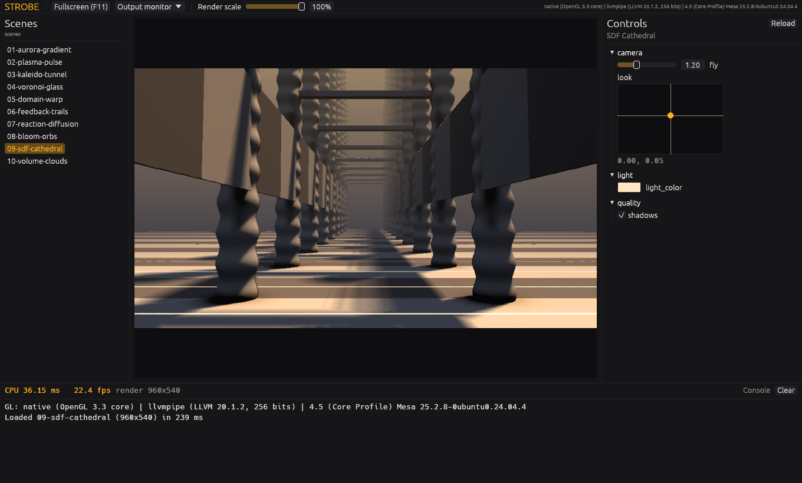
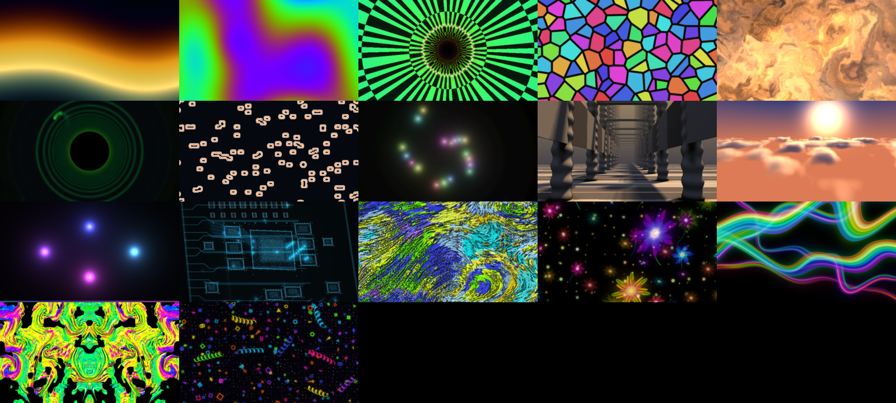

<div align="center">


# Strobe

**A Synesthesia-style VJ engine in Rust, built to run on old laptops.**

</div>

Strobe plays audio-reactive GLSL scenes on a projector or LED wall. It reads
Synesthesia scene folders (`.synScene`) as they are, runs their JavaScript,
imports Shadertoy shaders, and plays long shows from playlists.

> **Status: in development, no release yet.** The engine, the performer UI,
> playlists, show control and Shadertoy import are built and tested. Windows
> is the target and has been checked on two real machines: a ThinkPad T480
> (Intel UHD 620) and a desktop with a GTX 1080 Ti. Linux builds and runs
> (checked under Xvfb with Mesa). macOS does not run yet. What is verified,
> and where, is tracked in [`docs/STATUS_AUDIT.md`](docs/STATUS_AUDIT.md).



---

## What it does

**Plays Synesthesia scenes as they are.** It reads `main.glsl`,
`scene.json` and `script.js`, including:
- multipass and the SSF function library;
- every control type, with smoothing, speed, bangs and counters;
- images, cube maps, media and transition uniforms;
- the JavaScript API (`setup`, `update`, `setControl`, `setUniform`,
  `meta/` writes, `textureFinalPass`).

Real-world results:
- **65 owner-supplied scenes on NVIDIA:** 63 play with their scripts. The
  other two have bugs of their own.
- **A private 90-scene corpus:** 87 compile and render in both GL dialects.

**Imports Shadertoy shaders.** A "Send to Strobe" userscript
([`tools/userscript/`](tools/userscript/)) posts a shader from its page to
the app's local listener. The app converts it into an ordinary scene folder
that keeps the source and licence:
- buffers A to D become passes;
- the audio channel is your live sound;
- a generated control group adds speed, audio-driven time, a bass flash,
  zoom and hue.

**Generates controls for scenes that have none.** It finds the literals
that shape a scene (colours, scales, time factors and loop counts) and turns
them into controls. It keeps only those that measurably change the picture,
and writes the result to a copy of the scene, never the original. This runs
in a worker process, so the show keeps playing.

**Runs long shows from playlists.**
- **Inheritance:** a cue that names only a scene is complete. Duration,
  advance and transition come from its section and the playlist.
- **Writing a show:** playlists are TOML you can write by hand
  ([`playlists/`](playlists/)), or the Generate card builds a section from
  scene `TAGS` with a seed.
- **During the show:** every scene is compiled before it starts, the next
  scene warms up off screen, crossfades and custom transitions mix two live
  scenes, and the show resumes after a crash.

**Takes show control.**
- **MIDI and OSC in**, with learn, soft takeover and curves.
- **OSC feedback out**, so TouchOSC or motorised faders follow the show.
- **Performance Macros**, presets, and eight fav slots.
- **Keyboard shortcuts**, which you can rebind in the app.
- **Output-wide meta controls**: master, colour, mirrors and Limit Colors.
  They carry from scene to scene.

**Has a performer-first UI.**
- **The Perform view:** the live preview with the transport underneath.
  Panes open beside it: scenes, controls, playlist, editor, mappings,
  diagnostics and settings.
- **A command palette** (Ctrl+K).
- **A scene editor:** Save and reload, with the last good scene kept playing
  if the edit fails to compile.
- **Tag search, favourites and scene thumbnails** in the browser.

**Stays up on bad hardware.**
- **The floor is OpenGL 3.3**, roughly a 2012 Intel HD 4000.
- **Adaptive resolution** keeps heavy scenes at the display's frame rate.
- **ANGLE fallback:** when the native GL driver fails, Strobe uses ANGLE
  (OpenGL ES on Direct3D 11).
- **Context recovery:** a lost GL context is rebuilt and the show carries on.
- **Runaway scripts are stopped** within a per-frame budget.
- **Crashes leave evidence:** a report and a minidump that
  `cargo xtask symbolicate` turns into a stack with file and line.

| | Synesthesia | Strobe |
|---|---|---|
| Scene format | SSF | SSF, read as-is; Strobe's extensions are extra keys Synesthesia ignores |
| Shadertoy | Ported by hand | Imported from the page, multipass, live audio |
| Playlists | Each item carries its own settings | Inherited settings, a tag-based generator, beat-locked lengths, a wall-clock anchor |
| Broken GL driver | Does not start | Falls back to ANGLE |
| A `while(true){}` in a script | Hangs | Interrupted; the scene keeps rendering |

---

## Architecture

A Cargo workspace of fifteen crates. The rules that matter:
- **Only the app knows about everything.**
- **Only `strobe-gfx` touches the GPU.**
- **Everything that can be tested without a GPU is.**

```
                     strobe-ssf-lib          (the SSF GLSL library, as text)
                           ▲
                     strobe-scene            (scene.json, controls, presets, tags, shader assembly)
        ┌──────────┬───────┴──┬────────────┬─────────────┐
   strobe-gfx  strobe-audio strobe-script strobe-io  strobe-shadertoy
   (GL, only    (capture,   (QuickJS:     (MIDI, OSC  (Shadertoy JSON →
    unsafe)      FFT, BPM)   the JS API)   in & out)   scene folder)
        ▲                                                   ▲
        └────────────── strobe-autocontrol ─────────────────┘
                              (control generation; renders to score)

   strobe-playlist    (playlists: model, TOML, generator, clock; depends on nothing)
   strobe-diag        (logging, failures, crash capture; depends on nothing)

   strobe-app ── uses all of the above: windows, the frame loop, the UI
```

| Crate | What it owns |
|---|---|
| [`strobe-app`](crates/strobe-app/README.md) | The `strobe` binary. Two windows on one GL context, the frame loop, the egui UI (`ui/`), the show runner (`show/`), the editor, context-loss recovery. Also `strobe-corpus`, the compatibility harness: it loads, compiles and renders every scene of a library, scripts included, in both GL dialects, and writes a report. |
| [`strobe-gfx`](crates/strobe-gfx/README.md) | The GL boundary (the only `unsafe`, in `gl/`), context providers (native, ANGLE, headless, offscreen), the scene player, compositor, post stage, GPU timing and adaptive resolution. |
| [`strobe-scene`](crates/strobe-scene/README.md) | The SSF model: `scene.json` into a checked `SceneDef`, the control runtime, meta controls, presets, tags, and the shader assembler with its GLSL ES rewrites. No GL, no clock. |
| [`strobe-ssf-lib`](crates/strobe-ssf-lib/README.md) | The SSF GLSL function library and preambles. |
| [`strobe-script`](crates/strobe-script/README.md) | The QuickJS host for Synesthesia's JavaScript API, with an interrupt budget and a conformance suite. |
| [`strobe-audio`](crates/strobe-audio/README.md) | Capture on its own thread, FFT, bands, onsets, BPM, and the audio textures; a synthetic 120 BPM track for tests. |
| [`strobe-playlist`](crates/strobe-playlist/README.md) | Playlists: the model, TOML, inheritance, the seeded generator, the timeline and the playback clock. Pure. |
| [`strobe-io`](crates/strobe-io/README.md) | Show control: MIDI and OSC workers, mappings with learn and soft takeover, macros, OSC feedback, `show-control.json`. Never touches GL. |
| [`strobe-shadertoy`](crates/strobe-shadertoy/README.md) | Shadertoy import: URL and id parsing, the converter to a scene folder, the REST client, texture cache, the loopback listener, and `strobe-import`. |
| [`strobe-autocontrol`](crates/strobe-autocontrol/README.md) | Control generation: finds candidate literals, rewrites them to uniforms, renders to score each one, keeps those that matter. Also the `strobe-autocontrol` binary. |
| [`strobe-diag`](crates/strobe-diag/README.md) | Logging, the session context, structured failures, the panic hook and out-of-process crash capture with minidumps. |
| [`strobe-remote`](crates/strobe-remote/README.md) | The LAN remote's typed, versioned wire protocol. Protocol only: no server yet, and the app does not use it. |
| [`strobe-bench`](crates/strobe-bench/README.md) | Renders every scene in `scenes/`, times it, and writes frames, a contact sheet and `results.md`. |
| [`strobe-conventions`](crates/strobe-conventions/README.md) | The house rules as tests: file headers, the `unsafe` boundary, the toolchain pin. |
| [`xtask`](crates/xtask/README.md) | `cargo xtask ci`, `changelog`, `bench`, `corpus`, `symbolicate`, `brand`. |

### Graphics: native OpenGL, ANGLE as the fallback

Scenes are GLSL, and native GL hands GLSL straight to the driver's compiler,
as Synesthesia does. That is why Strobe does not use wgpu: its GLSL frontend
rejects too much real shader code. On Windows the native (WGL) path is the
one that breaks on hybrid-graphics laptops and old drivers, so the context is
a provider. Strobe tries native GL 3.3 core first. If that fails, or if
`--gl angle` asks, it opens OpenGL ES 3.0 through
[ANGLE](https://chromium.googlesource.com/angle/angle) on Direct3D 11, the
path Chrome uses. Everything above the context is the same code.

Every scene, imported Shadertoy shaders included, compiles as
`#version 330 core` on desktop GL and `#version 300 es` on ANGLE. The
assembler makes real SSF code valid GLSL ES:
- it writes out the implicit int-to-float conversions desktop drivers allow;
- it moves global initializers that are not constant into `main`;
- it reads an `#if` on an undefined name as 0.

### A frame

One thread owns the GL context and runs the frame. Workers for audio,
MIDI, OSC, OSC feedback, the import listener, file saving and the crash
monitor only hand values to it, through bounded queues it never waits on.
Each output frame, in order:

1. Drain MIDI and OSC into the control banks and commands, and queue OSC
   feedback for what has changed.
2. Advance the playlist clock: start cues, warm up the next scene, and run
   transitions.
3. Advance each live scene:
   - read its audio;
   - run its script;
   - tick its controls;
   - render its passes.
4. Mix the outgoing and incoming scenes while a transition runs.
5. Apply the meta post stage. It is skipped entirely when every value is
   neutral.
6. Present to the output window, which is the only vsynced swap.
7. Read the GPU timer of an earlier frame and adapt the render scale.

The control window redraws at 30 Hz in its own event, never inside the
output frame. Nothing compiles while a show plays, because playlists
compile every scene before they start. Per-frame paths do not allocate or
query the driver. Once a minute a `perf:` log line records:
- the frame rate;
- late frames;
- GPU time;
- the control window's cost.

The full walk-through is in
[`docs/ARCHITECTURE.md`](docs/ARCHITECTURE.md).

---

## Scene library

`scenes/` holds twelve original scenes, tagged:
- **Benchmark tiers:** ten span five tiers of GPU load, from a gradient,
  through feedback, Voronoi, domain warping, reaction-diffusion and bloom, to
  a raymarched cathedral and volumetric clouds.
- **`11-script-orbits`** is driven by a `script.js` physics loop.
- **`12-silicon-atlas`** is an animated, fictional circuit board.



*Rendered headless by `strobe-bench`. Timings for llvmpipe, the T480 and the
GTX 1080 Ti are in [`docs/BENCHMARKS.md`](docs/BENCHMARKS.md).*

---

## Building and running

You need the Rust toolchain pinned in `rust-toolchain.toml` (rustup installs
it) and a GPU with OpenGL 3.3, or Direct3D 11 for ANGLE. Windows builds use
the MSVC toolchain. The ANGLE DLLs come from `scripts/fetch-angle.ps1`.

```bash
cargo run --release -p strobe-app                              # the app
cargo run --release -p strobe-app -- --scene 05-domain-warp --show-output
cargo run --release -p strobe-app -- --playlist playlists/example.toml
cargo run --release -p strobe-app -- --gl angle                # force ANGLE
cargo run --release -p strobe-app -- --diagnose                # GPU and driver report
cargo run --release -p strobe-bench -- --size 1280x720          # render and time every scene
```

`strobe --help` lists every flag. The output window starts hidden; *Show
output* or F11 puts it on the projector. Keys: Left and Right step the
scene, Space holds, B blacks out, T taps tempo, Ctrl+K opens the palette.
Settings > Keyboard rebinds any of them.

Settings, show-control mappings, logs, crash reports and editor backups live
in the user data directory (`%LOCALAPPDATA%\strobe` on Windows). See
[`docs/DEBUGGING.md`](docs/DEBUGGING.md) for logs, `STROBE_LOG` and crash
symbolication.

### Developing

```bash
cargo xtask ci     # everything CI runs: fmt, clippy, tests, the Windows cross-check, cargo-deny, changelog, brand
cargo test --workspace
```

The renderer tests compile and render real shaders on a headless Mesa
context, in both desktop GL 3.3 and GLES 3.0, so a Linux machine with no GPU
covers both dialects. Install it with
`apt-get install libegl1 libegl-mesa0`.

Before changing code, read [`CLAUDE.md`](CLAUDE.md) and
[`CONTRIBUTING.md`](CONTRIBUTING.md). They hold the house rules: file
headers, no `unwrap` or `panic`, `unsafe` only at the GL boundary, and
commit conventions. Decisions and their reasons are in
[`docs/DECISIONS.md`](docs/DECISIONS.md).

---

## Licensing of imported shaders

Every Shadertoy shader carries its author's licence, and most are
non-commercial (CC BY-NC-SA 3.0 by default). Strobe records the source and
author of every import; check the licence before showing an imported shader
in a paid setting. Strobe ships only its own scenes. It reads scene folders
you point it at, and Synesthesia's scenes are covered by Synesthesia's EULA.

## License

MIT. See [LICENSE](LICENSE).
