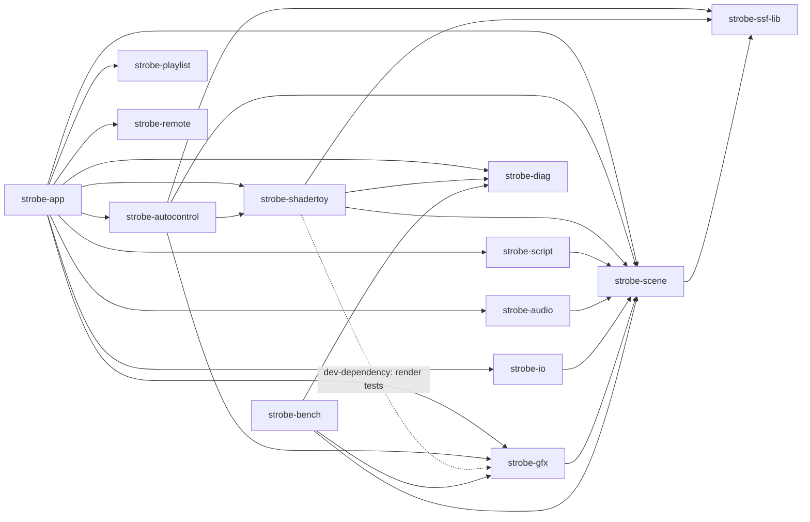

# Architecture


The diagram is [`images/architecture.svg`](images/architecture.svg), drawn by
hand in the brand palette; edit the SVG itself when the frame changes. "A
frame" below is the step-by-step version, with the code that does each step.

This document covers how Strobe is put together and why the boundaries
sit where they do. For *what's built so far*, see [ROADMAP.md](ROADMAP.md).

## Crates

```
crates/
├── strobe-scene        SSF model: scene.json → SceneDef, controls runtime, shader assembly
├── strobe-ssf-lib      The SSF GLSL function library (one .glsl file, include_str!)
├── strobe-gfx          GL boundary (only unsafe), context providers, scene player
├── strobe-audio        FFT, bands, onsets, BPM → the syn_* values; cpal capture thread
├── strobe-script       QuickJS host for the Synesthesia JavaScript API
├── strobe-bench        Benchmark + visual regression frames (headless or hidden-window context)
├── strobe-conventions  The house rules as tests (headers, unsafe boundary, toolchain pin, README gaps)
├── strobe-diag         Logger, session context, panic hook, native crash capture
├── strobe-shadertoy    Shadertoy export JSON → scene folder (id parser, model, dialect rewrite, converter, strobe-import)
├── strobe-autocontrol  Auto-generated controls: finds tunable literals, rewrites them to uniforms, keeps those that measurably change the image
├── strobe-app          winit event loop, control window (egui) + output window, wiring
├── strobe-playlist     Playlist model, TOML, generator, timeline, playback clock (pure)
├── strobe-io           Show control: MIDI and OSC workers, mappings, learn, soft takeover, macros (no GL)
└── strobe-remote       LAN remote: protocol, app-thread bridge, pairing, and the opt-in listener
```

(The localhost import listener stayed in `strobe-shadertoy`, D114. Presets and
fav slots are in `strobe-scene::preset`, D176; tags in `strobe-scene::tags`,
D205; OSC feedback in `strobe-io::feedback`, D209.)

### Dependency direction



Arrows point at what a crate depends on; this is `cargo metadata`'s
workspace graph. `strobe-playlist`, `strobe-remote` and `strobe-diag` depend
on no Strobe crate; `strobe-io` brings in `midir` and `rosc`, and
`strobe-remote` `serde`, `sha1`, `sha2` and `getrandom`. The app runs
`strobe-autocontrol` in a worker process (D202).

- `strobe-scene` knows nothing about GL, threads, or clocks: `dt` is
  passed in. Every SSF rule (control types, smoothing, pass layout, name
  matching, shader text) is tested there with no GPU.
- `strobe-gfx` knows nothing about audio capture, scripts, or playlists.
  It renders a scene given a `FrameInputs` (time, audio values, controls).
- `strobe-audio` and `strobe-script` must not depend on `strobe-gfx`.
  They produce values, and the app hands those values to the player.
- `strobe-shadertoy` depends on `strobe-scene`, to validate what it
  generates with `SceneDef::parse`, and on `strobe-ssf-lib`, to alias away
  a shader's names that the library compiled ahead of it also declares
  (D360). `strobe-gfx` must never depend on it;
  its render tests take `strobe-gfx` as a dev-dependency instead.
- `strobe-autocontrol` depends on `strobe-scene`, `strobe-ssf-lib`, the
  tokenizer and tab markers of `strobe-shadertoy`, and `strobe-gfx` (to
  render for scoring). `strobe-gfx` must never depend on it, and the frame
  loop never calls it: scoring runs at import time (D123).
- `strobe-io` depends on `strobe-scene` (for `ControlBank`, name matching
  and presets) and on `rosc` and `midir`, and **never on `strobe-gfx`**, a
  window or egui. It writes controls only through `ControlBank`, so toggle,
  bang and smoothing semantics have one implementation (D170). Its two worker
  threads own every blocking call and hand typed events to the app through
  bounded queues the app drains once per frame: notes, OSC and status in
  order, and the latest value of each MIDI fader (D171, D421).
- `strobe-remote` depends on no other Strobe crate and never on a window,
  egui or `strobe-gfx`. Its listener runs on threads of its own and reaches
  the app only through `bridge`: commands in on a bounded queue, a
  revisioned state snapshot out (D232, D250). The app drains it in step 1c.
  Its optional desktop bridge (D275) separately queues bounded UI events
  for the control-window egui pass and holds one shared latest JPEG frame.
  Only explicitly desktop-approved tokens can acquire the exclusive lease.
  `strobe-app::desktop` owns input translation, capture encoding and the
  native controller's decoding worker. No UI or renderer dependency enters
  `strobe-remote`; the original phone command bridge remains unchanged.
- `strobe-diag` depends on no other Strobe crate, so every crate may
  depend on it (for `log` output, `context::set`, `failure::report`).
  `strobe-gfx` itself only uses the `log` facade; the app is what installs
  the backend.

## The GL boundary

All `unsafe` lives in `strobe-gfx/src/gl/`, with one exception:
`strobe-diag/src/native.rs` holds the single call that installs the native
crash handler (D41). `strobe-conventions` allows exactly those two places.
Within the GL module:

- `gl/context.rs` creates contexts. It is the only place that makes a
  context current, and the only place a `Gl` is constructed, immediately
  afterwards.
- `gl/mod.rs` holds `Gl`, the safe wrappers (one GL call each), and the
  owning resource types (`Program`, `Texture`, `Framebuffer`,
  `VertexArray`, `Shader`), each released on `Drop`.
- `gl/prime.rs` runs once per context, from `Gl::from_loader` (which both
  the headless and the windowed providers call): one 16x16 draw before
  anything else draws, with the state put back, because AMD's WGL driver
  drops draws into large targets until a context has drawn into a small
  one (D311). It holds no `unsafe`.

`Gl` is `!Send`. A GL call is only defined on the thread where the
context is current, so the type system keeps `Gl` on that thread.

### Context providers

| Provider | Where | Dialect |
|---|---|---|
| `Headless::new(Api::DesktopCore33)` | Linux CI and the bench (Mesa llvmpipe via an EGL device display) | GLSL 330 core |
| `Headless::new(Api::Gles30)` | the same, for testing the ANGLE dialect | GLSL ES 300 |
| Windowed native | glutin: WGL on Windows, GLX/EGL on Linux (CGL on macOS is not built) | GLSL 330 core |
| Windowed ANGLE | glutin EGL with ANGLE's `libEGL.dll`/`libGLESv2.dll` beside the exe; its backend (D3D11 by default, or Vulkan, GL or Metal) chosen with `--gl angle-*` through `gl::angle` before any thread starts and checked against the renderer string once the context exists (D485); Vulkan also needs the `vulkan-1.dll` the release ships | GLSL ES 300 |
| `offscreen::run` | The bench and `strobe-autocontrol` (D140): `Headless` when an EGL device exists, else one hidden window's `WindowedContext` (Intel on Windows has no EGL device). Runs a job with `&Gl` and `&Caps`; main thread, once per process | whichever it opened |

## A frame

The **scene frame** (`strobe-app/src/app.rs`, `scene_frame`) is the frame. It
runs on the `next_output` schedule whether or not the output window can be
seen, because the control window's preview paints the scene's output texture
(D96). The output window starts hidden, and a hidden window may never get a
`RedrawRequested`, so `Running::schedule` decides who calls it:

- **output shown**: it requests a redraw (up to 144 Hz apart) and the redraw
  runs `scene_frame` on the output surface, then steps 5 and 8 below. The
  swap's vsync paces the loop.
- **output hidden**: `schedule` (from `about_to_wait`) runs `scene_frame`
  itself on the *control* surface, one refresh period of the output's monitor
  apart (60 Hz if unknown), and skips steps 5 and 8. Nothing is swapped, so
  nothing paces the CPU against the GPU; instead the frame is skipped while
  all four GPU timer slots are still waiting (`Performance::backlogged`),
  which bounds the queue to four frames when the context has a timer.

Everything below runs on the event-loop thread, in this order; worker
threads only ever hand values *to* it.

```
0. fault check (STROBE_FAULT), then make_current on the output surface (shown) or
   the control surface (hidden); a failure skips the frame and goes to the
   recovery policy (see "Context loss"). Hidden only: poll the timer ring and
   stop here if it is full
1. dt from the clock (fixed in screenshot mode); shown only, the interval since
   the last presented frame goes to AdaptiveScale's missed-refresh count (D314,
   D315: counted from each window's span, so CPU-timestamp jitter cancels);
   window and render-size housekeeping
1b. Show control (`Running::drain_remote`, `app::remote`): take up to 256 queued
    MIDI and OSC events (never blocks), run each through `strobe_io::Engine`,
    which writes the live session's scene and meta `ControlBank`s directly and
    returns commands, cue jumps, fav-slot and preset recalls, which the app
    carries out through the same `Action`s the buttons send (D171, D173)
1c. LAN remote, only while it is on (`Running::drain_lan`, `app::lan`): take
    up to 8 commands off `strobe_remote::bridge` (never blocks), check each
    against the app's state, run it through its command's `Action`, answer
    it; every 100 ms publish the state a phone shows (D254)
2. mouse uniforms from the pointer over the output window        (app::mouse)
3. GpuTimer::begin                                               (strobe-gfx::timing)
3a. Song watch (app::song, D489): one listen a frame to the live audio for a
    new track (a gap, or a new tempo that holds), or the operator's
    `new_song`; a song heard goes to Show::song_changed when a playlist is
    loaded (the live scene's transitions, and the clock's `audio-song` event,
    D237), else to the playing session's transitions
3b. With a playlist loaded and compiled (Show::frame, app::show::run):
     a. beat = BeatReader::read(audio frame's scalars)            (show::beat);
        breakdowns and drops heard in the audio's energy go to the clock as
        audio events (D226)
     b. PlaylistClock::tick(dt, &beat); drain_events into a buffer
        kept between frames; for each event:
          CueStarted        swap the cue's session into Stack::session (the old
                            one becomes `outgoing`); a warmed scene is grown
                            with resize_keeping, a cold one is resized; control
                            defaults, then the cue's overrides
          WarmUp            take the next scene from the cache, apply its
                            overrides, render it at half each edge
          TransitionStarted pick the Blend (crossfade, fade-through-black or a
                            custom transition compiled at load)
          CueSkipped, HoldChanged, PlaylistEnded   console, banner
          BlackoutChanged   the app's blackout flag
     c. step 4 below for the live scene, the outgoing scene and the warming
        scene, each with its own clock
     d. while clock.transition() is Some: Compositor::render(outgoing, live,
        blend, progress) into the compositor's own target
     e. a finished transition parks the outgoing scene (targets cut to 1x1)
     f. shader-compile counter check; SaveTimer (resume point to its thread);
        file watcher poll (once a second)
   With no playlist this step is absent and the live scene is advanced by step 4.
4. Session::advance:
     a. scene clock += dt
     b. audio frame at that time: live snapshot (one atomic load + copy) or
        the synthetic track                                       (app::audio)
     c. script, if the scene has one: events, then update(dt), then control
        writes (scene and meta/ banks) and uniforms harvested; the script
        reads textureFinalPass from the readback of two frames ago
                                                                  (strobe-script)
     d. ControlBank::tick(dt), for the scene's bank and the meta bank, and
        Transitions::step(dt): a smooth transition's crossfade (strobe-scene)
     e. ScenePlayer::upload_audio: spectrum and level-trail texels
     f. ScenePlayer::set_script_uniforms is called with step c's values
     g. ScenePlayer::render(&FrameInputs): every pass, then, only for a
        script that names textureFinalPass, the final-pass readback: a
        chain of <=2:1 blits down to 64x36, glReadPixels into the next of 3
        pixel-pack buffers, a fence behind it, and the oldest buffer mapped
        only if its fence has already signalled        (strobe-gfx::readback)
4b. Meta reactivity and audio speed (live session's meta bank) multiply the
    audio panel's gains on the analyser (AudioInput::set_meta_gains, D184),
    set before step 3b so the frame's audio is already scaled
4c. Output post stage (App::apply_post, strobe-gfx::post, D180): the live
    session's meta bank is read into a Copy `MetaValues`. If every value is
    neutral, NOTHING runs and the frame stays as step 4/3d left it. Otherwise
    one full-screen pass reads the final frame (the compositor's mix while a
    transition runs, else the scene's output) into Post's own RGBA8 target
5. Post::present, or Compositor::present while a transition runs, or
   ScenePlayer::present: letterboxed blit to the output window (shown only).
   Blackout (D135) clears instead, after the post stage (D181)
6. GpuTimer::end, then poll: results of earlier frames that are ready (never
   waited for) go to AdaptiveScale; a new scale triggers a resize next frame
   (the live scene restarts its feedback, D64; a playlist's outgoing and
   warming scenes keep theirs with resize_keeping, D440)
7. reset-status health check, at most once a second, on a robust context only
8. swap (shown only; vsync paces the loop); a failure asks the driver for the
   reset status and tells the recovery policy, a success tells it the window
   presented
```

The GPU timer brackets steps 3b to 5, so hidden it brackets the scene alone;
the budget it is judged against is the same one refresh period, so adaptive
resolution behaves the same either way. In screenshot mode a shown output is
read back from its own back buffer and a hidden one from the scene's output
texture.

The control window redraws at 30 Hz in its own event, never inside the output
frame: it refreshes the console from `strobe-diag`'s ring (only if the record
count moved), reads the audio status (at most twice a second), runs one egui
pass over a `Model` and applies the `Action`s it returns, and paints the
scene's output texture as the preview.

**Where the post stage sits.** It is the last thing that touches pixels and it
is after the compositor, so a crossfade between two scenes is faded as one
picture, not twice. The compositor mixes the two scenes' frames; post then
applies the output's master, colour and mirror to the mix. Its target is the
same size as its source, so the preview, the letterboxed present and a
screenshot all read the post stage's target when it ran this frame
(`App::posted`) and the scene's or the compositor's otherwise. At neutral
there is no pass and no extra target traffic, which is what an HD 4000
needs. Step order inside it is documented in `strobe_gfx::post`.

Loading a playlist is not in the frame at all. `Running::compile_show_step`
runs once per control-window frame, after that frame is painted, and compiles
one scene (or one custom transition) with the context current on the control
surface; the scene frame does not tick the clock until every step is done.
See D150-D158.

## The control window's UI (`strobe-app`)

**Contextual Perform** (D120, built in stage 1 as D130 to D138). The UI is a
pure function of a borrowed `ui::Model` that returns `Action`s; the app owns
every piece of state and carries the actions out after the frame is painted.

The window has followed Synesthesia's layout since D281, and its panes were
rebuilt on one form grammar in D464 to D484 (docs/UI_REVIEW.md):

```
title bar: brand, crumb, frame rate, output, audio, remote; other readouts only when they need attention (D472)
---------------------------------------------------------------------------------------------------------
rail (84 pt, words) | main view: the view the rail chose          | side panel (31%): preview, status strip,
Library, Controls,  | (Library, Controls, Import, Playlist,       | fav slots, Playlist / Controls /
Import, Playlist,   |  Editor, Mappings, Diagnostics, Settings)   | Presets / Scene tabs
Editor, Mappings,   |                                             |
Diagnostics, Settings                                             |
---------------------------------------------------------------------------------------------------------
transport strip: prev, hold, next, NOW and NEXT, time, BPM, BLACKOUT
macros: the operator's pinned Performance Macros (the scene's first controls until there is one)
help bar: what the control under the pointer does
```
The Mappings view (`ui::map`) holds the OSC and MIDI connections, the macro
set, the mappings with learn and the activity monitor (D177, D467); the
side panel's Presets tab holds the presets and, in a short window, the eight
fav slots (`ui::presets`, D176, D484).

Layers (UI_IMPLEMENTATION_PLAN section 3), and where they are:

| Layer | Code |
|---|---|
| product state | `app.rs` (`Running`), `session.rs`, `audio.rs`; per-scene `library::Health` |
| presentation state | `ui::state::UiState`, saved by `prefs` (a debounced writer thread, D133) |
| adapters | `ui::model`: `Model` and its panels, borrowed for one frame |
| commands | `ui::model::Action`, and `commands` (the keyboard table and focus rule, D134) |
| rendering | the preview paints the scene's output texture as a native egui texture; there is no readback |

Portable modules (no egui, unit-tested anywhere): `color`, `palette`,
`motion`, `icon`, `workspace` (the pane model and how it fits a window),
`prefs`, `commands`, and `library` (search, filter, health and stepping). The
egui layer is `ui/`: `theme`, `motion` and `icon` bind the portable ones;
`fonts` loads the system's Segoe UI (D465); `widgets`, `form` (pages, group
cards, setting rows, toggles, fields: the grammar every pane uses, D466) and
`modal` are the shared vocabulary; `shell` composes `chrome` (title bar and
rail), `side` (the side panel), `perform`, `transport`, `macros` and `help`
with the views `browser`, `inspector` (with `controls`, the Controls view and
tab, and `presets`), `import`, `playlist`, `editor`, `map`, `diagnostics` and
`settings` (with `audio` and `lan`, the Remote page); `command_palette`,
`tags` and `thumbs` serve several of them; `keys` turns key events into
commands; `host` runs egui on the control window. Outside `ui/`, `picker`
opens the native file and folder dialogs (`rfd`) on a thread of their own
and is polled for the choice (D470), and `lan` runs the remote
listener and the LAN discovery responder and scanner (D468).

What a control-window frame does (30 Hz, off the output frame's path):

1. refresh the console and the audio status (cheap, as before);
2. if a load or a preview was asked for last frame, remember it (the UI shows
   "preparing" this frame);
3. advance the browser's preview session, if there is one;
4. register the preview textures, and build the `Model` (no allocation beyond
   the model's own borrows);
5. one egui pass: `shell::show` (hashing `UiState` to notice a change, reading
   key events, drawing), then paint;
6. `UiState::tick` (debounced save), the `--screenshot` capture if due,
   present, then apply the actions;
7. only now, run the blocking load or preview preparation, so the frame that
   said "preparing" has been on screen.

New in the frame path, all in `app.rs`:

- **Scene stepping** (`library::step`: wraps, skips scenes known to fail).
- **Blackout**: when the output is shown, `scene_frame` clears it to black
  instead of calling `present`. The scene keeps rendering.
- **Two-phase load** and a **per-scene health** vector, so a failed load
  leaves the old scene live and marks the row.
- **A second `Session` for Preview**, kept in the `Stack` before the context
  in drop order, rendered at 384 px and dropped on a context rebuild.
- **A notice** after a context rebuild ("rebuilt on ANGLE in 181 ms; the scene
  is playing again").
- **The title bar**: `Layout::initial` opens the control window undecorated
  when `custom_title_bar` is set, and `Action::SetCustomTitleBar` flips it
  live (D132).

The rules that keep it cheap and honest, each a test: the drawing modules
hold no colour literal, hand-picked gap, hand-rolled animation or font icon;
no fixed panel has a dead resize handle; nothing in them touches the disk,
the driver or a socket; `shell_tests` draws every state at ten window sizes
and asserts it fits; `palette` checks every theme's contrast. The per-frame
cost is measured and shown (`Control UI` in the diagnostics: the egui layout pass, about 1 ms in a
debug build; the GL paint is the driver's and the T480 number is open).

## Context loss

A projector must never go dark because one driver call failed (D66).

- **Detection** (`strobe-gfx`): both backends request a robust
  (`RobustLoseContextOnReset`) context and fall back to default attributes if
  the driver refuses, logging which they got (`WindowedContext::robust`).
  `Gl::reset_status()` loads `glGetGraphicsResetStatus` (plain, `ARB`, `KHR` or
  `EXT` name, chosen by version and extensions) through the glow loader. It is
  a driver round trip: it runs after a failed swap and as a once-a-second
  health check, never per frame, and never after a failed `make_current`.
- **Lost flag**: `Gl::mark_lost()` sets a flag shared by every clone; every
  owning type (`Program`, `Texture`, `Framebuffer`, `Shader`, `TimerQuery`,
  `VertexArray`) skips its delete on drop when it is set, and egui's painter is
  abandoned rather than destroyed. The driver frees a destroyed context.
- **Policy** (`strobe-app/src/recovery.rs`): a pure state machine, fed
  failures, reset statuses, successes, rebuild results and time. Three failed
  frames on a window, or any reset report, mean rebuild; a second native
  rebuild within 60 s, or a failed native rebuild, means ANGLE (only when
  `--gl auto`); ANGLE failing too, or more than four rebuilds in 60 s, means
  give up through the normal failure dialog.
- **Rebuild** (`Running::recover`, run from `App::settle` where the
  `ActiveEventLoop` is available): mark lost, drop the session, timers, egui,
  **both windows** and the context, in that order (WGL sets a window's pixel
  format once, so windows are never reused), release the context from the
  thread (glvnd refuses an EGL context while a GLX one is current), build a new
  `Stack` on the chosen backend, restore fullscreen, monitor, maximized and
  shown/hidden state (the output window is recreated with the same
  visibility), resume the adaptive render scale, and reload the scene at its clock
  with its control values. Audio, library, console and screenshot state are
  not GL state and carry over untouched.
- **Records**: each loss and rebuild is a `CONTEXT` failure record, plus an
  `INFO` line the console shows. `STROBE_FAULT` injects a loss for testing
  (DEBUGGING.md).

## Diagnostics wiring

`main` follows `strobe_diag`'s documented order: register the notifier (the
same `dialog::show_error` the startup-failure path uses), run as the crash
monitor if asked, `strobe_diag::init()`, `--diagnose`, then
`crash::start_monitor()` held for the run. After the GL context exists its
vendor, renderer, version and backend go into the session context, driver
debug output is switched on (`gldebug`), and the scene name, render size and
frame counter are kept current. Shader compile failures, scene load errors,
script faults, resize failures and startup failures are `strobe_diag::failure`
records (`failures.rs`), so the log, the console and a crash report agree.

## Audio, scripts and performance

- **Audio** (`audio.rs`): one `AudioInput` for the run. Capture opens on a
  thread; synthetic audio plays until it is up and whenever capture is in
  `SilentFallback`. Settings (device, reactivity, speed, tap tempo) live in
  the app and are applied through the capture's atomics.
- **Scripts** (`script.rs`, `session.rs`): one `ScriptHost` per scene. Its
  first frame runs at load so the uniforms it creates are compiled into the
  shaders (`ScenePlayer::with_extras`), after which the uniforms are sealed:
  a later new name is refused and nothing compiles mid-show (D62, D161).
  Writes to `meta/` controls go to the session's meta bank
  (`strobe_scene::meta`, D160), which the output post stage renders from
  (D180).
- **Performance** (`perf.rs`): GPU time from a four-slot ring of timer
  queries feeds `AdaptiveScale`; budget is one refresh period of the output
  monitor; the render-scale slider is the ceiling; nothing changes in the
  first second after a scene load. See D64. Shown with vsync and a known
  refresh rate, each presented frame's interval feeds it too, and sustained
  missed refreshes step the scale down even with the mean under budget
  (D314).

## Scene player internals (`strobe-gfx/src/player.rs`)

- **Programs.** By default there is one program per pass, with
  `const int PASSINDEX = n;`. The alternative is one shared program with
  `uniform int PASSINDEX`. Uniform locations and sampler units are
  resolved when the program links and stored in `Compiled`.
- **Targets.** Each listed pass gets one texture plus FBO, or two when
  `DOUBLE_BUFFER` is set (ping-pong). The final pass always ping-pongs,
  so `syn_FinalPass` is the previous frame. Every new target is cleared
  to `vec4(0)`.
- **Read rule.** When pass `i` samples target `j`: for `j < i` it reads
  this frame's output; for `j >= i` it reads last frame's.
- **Audio textures.** `upload_audio(&AudioTextures)` quantises the spectrum
  and level-trail texels into staging buffers kept between frames and
  uploads only a texture some pass samples (1D on desktop, one-texel-high 2D
  on GLES).
- **Final-pass readback.** `enable_final_pass_readback` builds a
  `readback::FinalPassReader`: the downsample chain and a ring of three
  pixel-pack buffers, each with a fence. `render` ends with `capture`: blit
  down, start a read, poll the oldest slot with a zero-timeout wait and
  copy it out only if signalled. `final_pass_pixels` is the frame two
  renders ago (D162). No `glGet*`, no allocation, no wait.
- **Script uniforms.** `with_extras` declares the script's uniforms in every
  program and resolves their locations at link time; `set_script_uniforms`
  copies this frame's values into a reused buffer.
- **Cube maps.** Loaded at scene load by `assets::load_cubemap` (six faces,
  or one strip/cross picture) into a `gl::Texture` whose target is
  `TEXTURE_CUBE_MAP`. A cube that fails stays `None`, its sampler reads a
  1x1 black cube, and the reason is returned by `take_asset_problems()` for
  the host's failure path (D185).
- **Media.** `media::Media` holds the `syn_Media` picture: a decoder thread
  (`assets::spawn_decoder`) sends decoded pictures, `render` uploads at most
  one per frame (`poll_media`), and `current(time)` only picks which
  already-uploaded texture to bind. `set_media` swaps in a user-chosen file
  once its first picture lands (D186).
- **Sampler units.** Units are assigned in a fixed order: `syn_FinalPass`,
  `syn_Media`, `syn_Spectrum`, `syn_LevelTrail`, `strobe_ShadertoyAudio`,
  pass targets, images,
  cubemaps. Each sampler gets its own unit even when the driver optimised
  it out, so a `samplerCube` never shares a unit with a `sampler2D`,
  which GL rejects at draw time.

## Shader assembly (`strobe-scene/src/assemble.rs`)

```
#version 330 core | #version 300 es (+ precision statements)
uniforms: standard, audio scalars, syn_Spectrum/LevelTrail, controls,
          pass targets, images, cubemaps, transition uniforms, script extras
const float PI; vec2 _xy, _uv, _uvc; out vec4 strobe_FragColor;
#define texture2D texture
<strobe-ssf-lib>
#line 1 1        ← user code is source string 1
<main.glsl>
#line 1 2
void main() { _xy/_uv/_uvc setup; strobe_FragColor = renderMain(); }
```

`map_error_line` reads Mesa, NVIDIA and ANGLE/AMD/Intel log formats, so
an error points at `main.glsl:N`. Where the driver gives a column (Mesa
only), `driver_column`, `compiled_column` and `original_column` put it
back on the user's line, and the error reads `main.glsl:N:C` (D263).

## Playlists (`strobe-playlist`)

Pure: no GL, no threads, no system clock, no I/O except `file::load` / `save`
and `ResumePoint::save` / `load` (both atomic). Depends on serde, toml and
thiserror only; it does not depend on `strobe-audio` or `strobe-scene`
(the clock takes a `BeatInfo`, overrides use its own `ControlValue`).

| Part | Module | Entry points |
|---|---|---|
| model | `model`, `duration` | `Playlist`, `Section`, `Cue`, `CueSettings`, `DurationSpec` (`90s`, `1:30`, `32 bars`, `rand(a, b)`) |
| inheritance | `resolve` | `resolve()` to `ResolvedCue`, `identity()`, `distinct_scenes()` |
| file | `parse`, `write`, `file` | `parse::parse`, `write::to_toml`, `file::load` / `save`; errors carry line and column |
| generator | `generate`, `rng` | `generate(&LibrarySnapshot, &GenerateSpec)` to a `Section`; `SplitMix64` |
| timeline | `timeline`, `schedule` | `Timeline::from_playlist`, `total_runtime`, `locate`, `place`, `wall_time` |
| playback | `clock`, `tempo` | `PlaylistClock::tick(dt, &BeatInfo)`, `apply(Command)`, `drain_events()` |
| resume | `resume` | `PlaylistClock::resume_point()` / `restore()`, `ResumePoint` TOML |

The playlist tick sits where the frame section above says it will (step 3b):
after input, before the scene renders. It lives in `strobe-app`'s `show`
module, which is the glue and the only place the pure crate meets a GPU:

| Module | What |
|---|---|
| `show::run` | `Show`: the precompile (one step per control frame), the frame, warm-up, transitions, commands, the compile counter. Lent an `Env` (context, the live scene's slot, the compositor, audio) per call. |
| `show::cache` | `SceneCache<T>`: a slot per distinct scene, progress, take and put back. Each slot holds a parked `Session` (targets at 1x1, D151). |
| `show::resolve` | Scene references to folders (exact library names, paths beside the playlist); control overrides to `ControlBank` writes, with a reason for each refusal. |
| `show::start` | Wall clock, then resume point, then the first cue. |
| `show::resume`, `show::watch` | The resume file on its own thread, every 5 s; the file watcher (a `stat` a second). |
| `show::view`, `show::generate` | Timeline rows for the Playlist view; the Generate form and the library snapshot. |
| `ui::playlist` | The Playlist view. |

Where a scene is at any moment: the cache (parked, 1x1), `Stack::session` (the
clock's current cue, full size), `Show::outgoing` (during a transition, full
size) or `Show::warming` (from `WarmUp` to its cue, half each edge). A scene is
in exactly one of them. `strobe-gfx`'s `Compositor` mixes live and outgoing at
the clock's `progress`; its program is compiled once when the context opens.
`Gl::shader_compiles()` is how a test or the show itself proves nothing
compiled after the load. See D73-D77 for the clock's rules and D150-D158 for
the app side.

## Shadertoy import (`strobe-shadertoy`)

Four layers, kept apart (AGENT_RESEARCH section 9). Acquisition (D110-D117)
ends in the same JSON the converter reads, so a shader fetched by id, sent
by the userscript or dropped as a file is converted the same way.

```
(a) id        ShaderId::parse        URL / embed link / bare id          id.rs
(b) model     Shader::from_json      API {"Shader":..} or bare export     model.rs
    acquisition  REST API by id (path B), loopback listener for the       acquire/, listener/
                 userscript (path A), textures into a shared cache
(c) convert   convert(&Shader, &Options) -> Converted                    convert/
      plan      order buffers A..D, bind channels, decide the clock       plan.rs
      dialect   token-level rewrite of each tab's code (D94)              dialect.rs, glsl.rs
      shim      per-pass GLSL: shim + Common + tab + entry (D91)          shim.rs
      scene_json  scene.json from Serialize structs (deterministic)       scene_json.rs
      write     hidden staging folder, one rename                         write.rs
(e) strobe-import <file.json> [--out DIR] [--name N] [--assets DIR] [--strict] [--force]
```

What it writes, and how the player runs it:

```
<name>-<id>.synScene/
  scene.json            PASSES [st_clock?, st_buf_a..d], PASS_SOURCES, IMAGES,
                        CONTROLS (the five "Strobe" controls), SOURCE
  main.glsl             the Image pass (the final PASS_SOURCES entry)
  passes/*.glsl         st_clock (when a pass reads time), buffer_a..buffer_d
  images/               fetched textures, st_black.png, pending-assets.json
```

- The player builds one program per pass from that pass's own file
  (`SceneFolder::shader_for`), names the file in compile errors
  (`file_for`), and ignores a request for a shared program (D90).
- `st_clock` is an ordinary one-pixel float pass; nothing in the frame loop
  knows about it (D91).
- Audio inputs sample `strobe_ShadertoyAudio`, filled inside
  `upload_audio` only when a pass samples it; `iDate` is `strobe_Date`
  (D93).
- Every fixture under `crates/strobe-shadertoy/tests/fixtures/` is original
  and in exact export shape; the render tests convert, write, load and
  render them on both dialects.

## Auto-generated controls (`strobe-autocontrol`)

Pure analysis, a rewrite that keeps line numbers, and one stage that needs a
GL context. See D123-D126 for the rules. The library takes the context from
its caller (`generate(&Gl, &Caps, ..)`); the CLI gets one from
`strobe_gfx::offscreen`, headless or a hidden window (D140).

```
Sources (per-pass GLSL)          source.rs     Scan: tokens + offsets + depth;
   │                                           Shadertoy shim/entry excluded
   v
analyze()  -> Candidate[]        analyze/      consts (#define/const), expr
   │                                           (time, loops, colour, scale/freq)
   v rewrite::apply (ALL as uniforms, placeholder names)
   v score::Rig::new  (compile once)
   │   per probe: reset history, fresh ControlBank, 10 frames @160x90,
   │   synthetic audio; score = mean |diff| to baseline, nudged down and up
   v
dead / black / does-not-compile dropped, top K kept   generate.rs
   v naming::assign, rewrite::apply (only the kept), verify compile + fidelity
Generated { report, sources, control_lines, folder }
   v output::write_scene           <name>-auto.synScene (a copy; the worker never
                                   writes the scene it measured, D202)
```

- `Rig` compiles the scene once; probes only change uniform values.
- The original scene is compiled and rendered first, so a broken scene is
  reported as such, and the finished scene's default picture is compared with
  the original (`Report::fidelity`).
- The app runs it in a worker process (`strobe-autocontrol` as a child,
  D202), so a slow or crashing measurement never touches the show. Its
  review (D219) keeps, drops, renames and re-ranges each control; the
  result is opened as the copy or, on *Save to this scene*, copied back
  over the files it rewrote, each backed up first (`generate::save_into`,
  D488).
